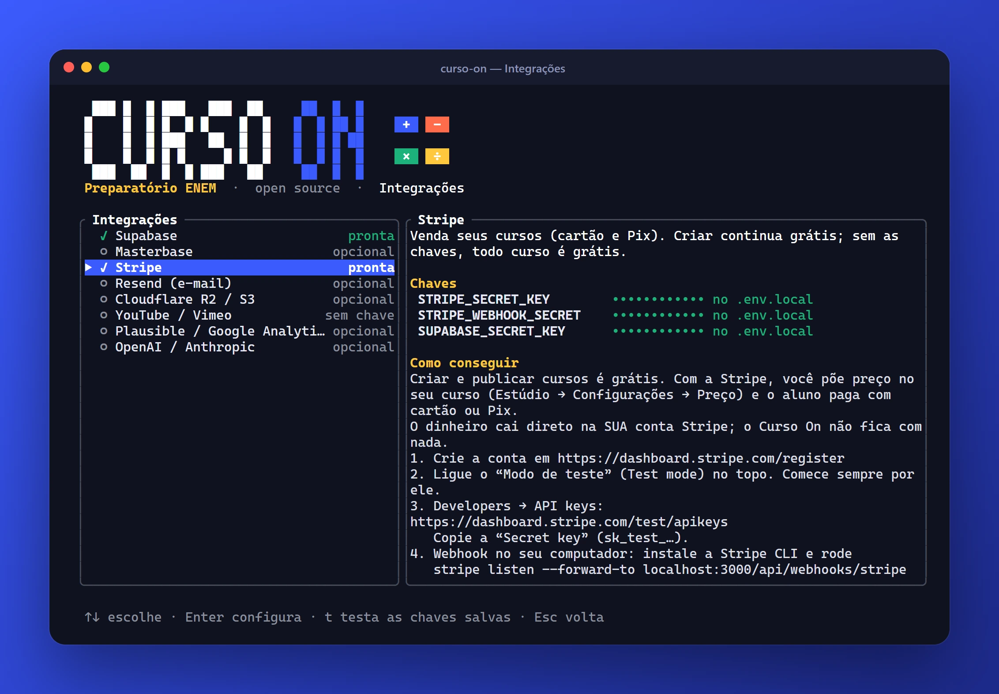
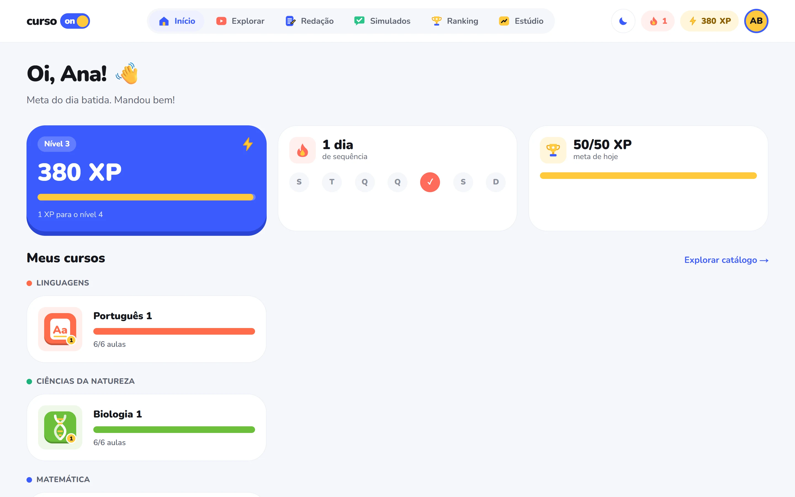
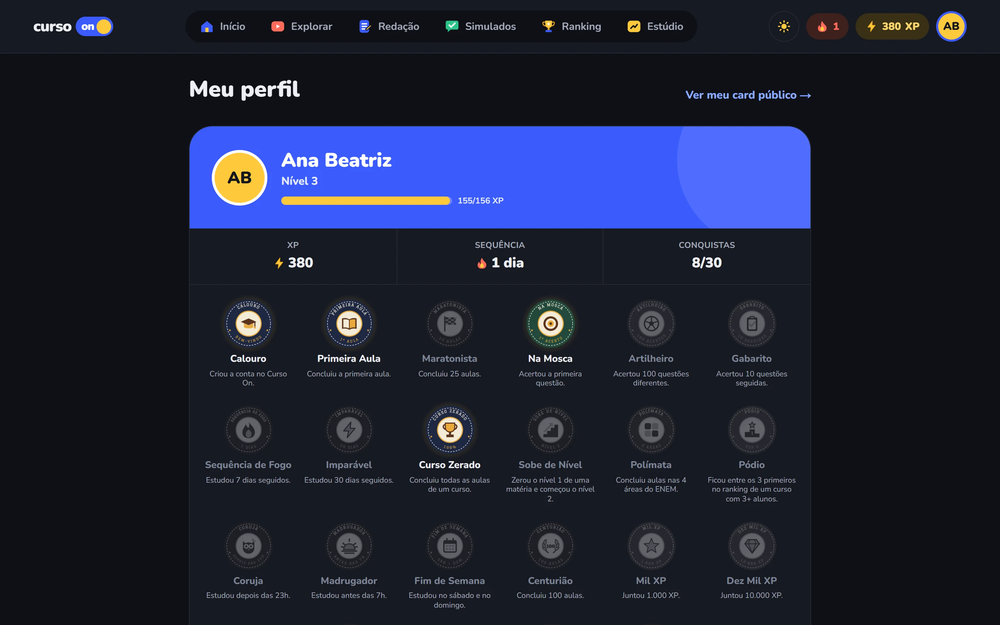
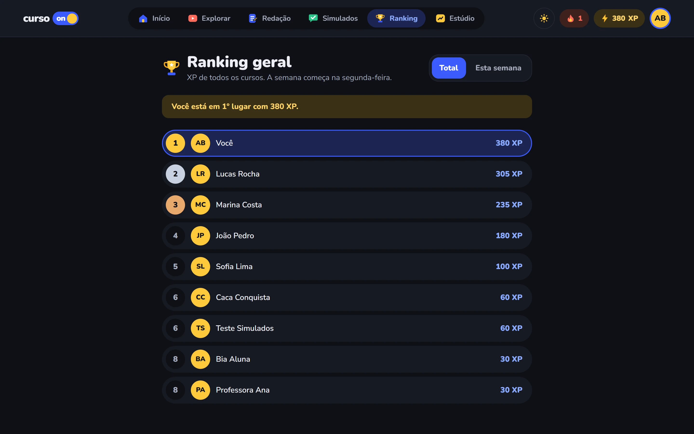
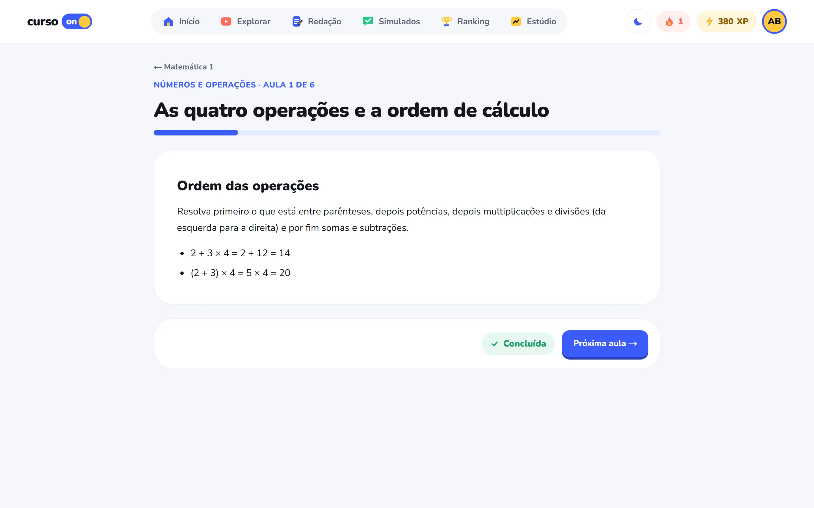
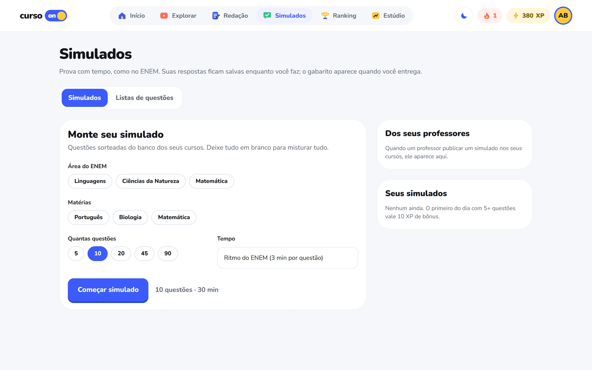
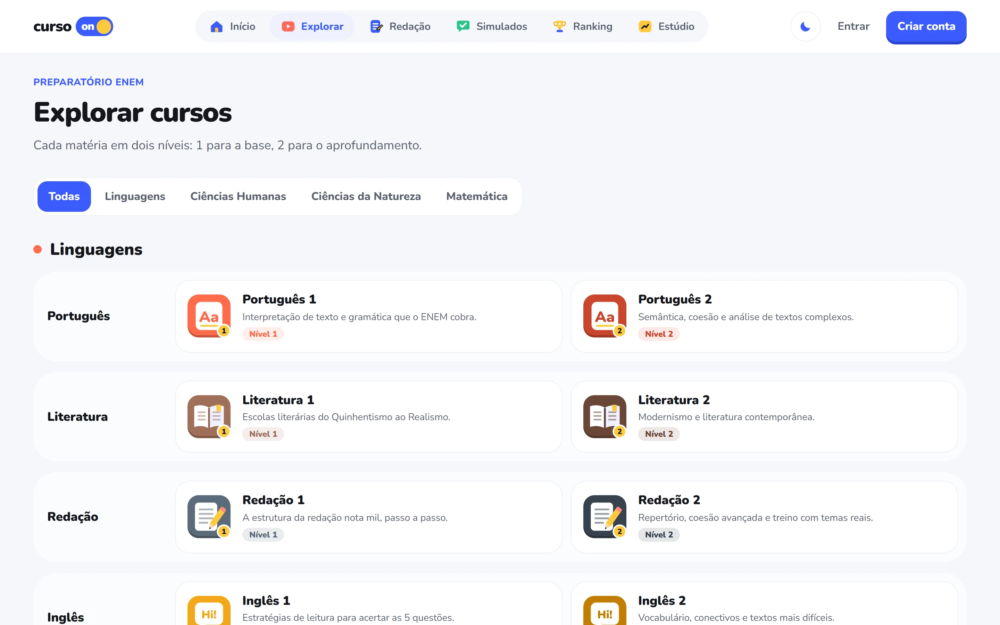
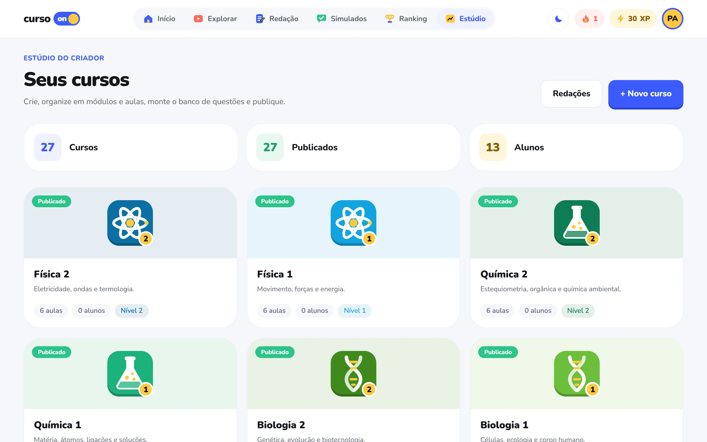

<div align="center">

# Curso On

**A plataforma open source para criar cursos preparatórios para o ENEM.**
Grátis para criar, publicar e estudar. Se quiser, venda o seu curso, e o dinheiro vai direto para você.

[](LICENSE)
[](https://github.com/caioribi7/curso-on/releases/latest)
[](https://github.com/caioribi7/curso-on/actions/workflows/ci.yml)


</div>

Aulas curtas separadas por matéria do ENEM, banco de questões com LaTeX, simulados com tempo, correção de redação, XP, ranking e 30 conquistas para colecionar. Você não precisa saber programar: um comando instala o painel **`curso-on`**, feito em Rust, e ele configura tudo pelo terminal, do banco de dados ao seu primeiro curso.

## Instalação em 1 comando

**Linux e macOS**

```bash
curl -fsSL https://raw.githubusercontent.com/caioribi7/curso-on/main/install.sh | sh
```

**Windows (PowerShell)**

```powershell
irm https://raw.githubusercontent.com/caioribi7/curso-on/main/install.ps1 | iex
```

Depois rode `curso-on` e siga o menu: **Configurar → Abrir a plataforma → Criar conta → Importar cursos ENEM**. O instalador baixa o painel da [última Release](https://github.com/caioribi7/curso-on/releases/latest), confere o SHA-256 e coloca no PATH. Você só precisa do [Node.js](https://nodejs.org) (LTS) e do [Git](https://git-scm.com); para rodar o banco no seu computador, do [Docker](https://www.docker.com/products/docker-desktop/).



Nunca usou nada disso? O [guia para iniciantes](docs/primeiros-passos.md) explica cada passo, inclusive como criar a conta no Supabase. O mesmo guia abre dentro do painel. Prefere compilar? `cargo install --git https://github.com/caioribi7/curso-on curso-on`

## Grátis para criar. Venda se quiser.

Criar conta, montar cursos, publicar e estudar não custa nada, e o código é seu (MIT). Quem quiser cobrar liga a **Stripe** no painel (**Integrações → Stripe**) e põe preço no curso em **Estúdio → Configurações → Preço**. O aluno paga com cartão ou Pix, o acesso libera sozinho e o dinheiro cai na sua conta Stripe. O Curso On não fica com nenhuma parte.

- **Preço 0 = grátis.** É o padrão de todo curso. Cursos grátis e pagos convivem na mesma plataforma.
- **Sem a Stripe ligada, ninguém consegue comprar** e nada é cobrado. Curso com preço fica com a compra pausada.
- **O acesso só nasce do webhook assinado da Stripe.** Nenhum truque no navegador abre um curso pago: o banco recusa (veja `supabase/tests/vendas.test.mjs`).
- **Reembolso tira o acesso** que veio da compra; o progresso do aluno continua guardado.
- O criador vê as vendas e o total recebido na aba **Alunos** do curso.

## Por dentro

<table>
  <tr>
    <td width="50%"><br><b>Painel do aluno.</b> Nível, XP, sequência de dias e meta diária, com os cursos agrupados por área do ENEM.</td>
    <td width="50%"><br><b>Trilha do curso.</b> Módulos e aulas em ordem, progresso, meta do dia e ranking da turma.</td>
  </tr>
  <tr>
    <td><br><b>Card do aluno.</b> 30 medalhas que o banco libera sozinho (Calouro, Na Mosca, Curso Zerado, Coruja…). O card também tem versão pública.</td>
    <td><br><b>Ranking.</b> Geral e da semana, além do ranking de cada turma.</td>
  </tr>
  <tr>
    <td><br><b>Aula.</b> Texto em Markdown, vídeo do YouTube/Vimeo e fórmulas em LaTeX. Concluir dá XP.</td>
    <td><br><b>Simulados e listas.</b> Prova com tempo, no ritmo do ENEM, e listas de questões prontas para imprimir em A4.</td>
  </tr>
  <tr>
    <td><br><b>Catálogo.</b> As 13 matérias do ENEM por área, cada uma com nível 1 (base) e nível 2 (aprofundamento).</td>
    <td><br><b>Estúdio.</b> Crie cursos, módulos, aulas, questões e simulados, corrija redações e acompanhe alunos e vendas.</td>
  </tr>
</table>

<p align="center">
  
  &nbsp;
  
  <br><sub>Feito para o celular, com tema claro e escuro.</sub>
</p>

## Funcionalidades

| Área | O que tem |
|---|---|
| **Cursos por matéria** | As 13 matérias do ENEM em 4 áreas, cada uma em dois níveis. Módulos e aulas com ordem, vídeo, texto, prévia grátis e XP. O painel importa 26 cursos prontos (156 aulas, 55 questões). |
| **Banco de questões** | Múltipla escolha com explicação, dificuldade e XP. Enunciados e alternativas aceitam LaTeX (`$x^2$`, `$$\frac{a}{b}$$`), renderizado com KaTeX. |
| **Simulados** | Monte um simulado sorteando do banco (área, matéria, quantidade, tempo) ou faça os simulados publicados pelo professor. As respostas ficam salvas e o gabarito aparece na entrega. |
| **Listas imprimíveis** | Junte questões, reordene e imprima (ou salve em PDF) com cabeçalho de nome, turma e data e gabarito opcional. |
| **Redação** | O professor abre temas, o aluno envia texto ou foto/PDF, e a correção sai nas 5 competências do ENEM. Pré-correção por IA opcional (OpenAI ou Anthropic); a nota final é sempre do professor. |
| **Gamificação** | XP, níveis, sequência de dias, meta diária, ranking geral, semanal e da turma, e 30 conquistas com medalhas próprias. |
| **Venda (opcional)** | Preço por curso, Stripe Checkout (cartão e Pix), liberação automática por webhook, reembolso e painel de vendas. |
| **Tema** | Claro e escuro, seguindo o sistema, com botão para trocar. Transições suaves em todo o app (veja [docs/transicoes.md](docs/transicoes.md)). |
| **Auth** | Cadastro, login, Google OAuth, confirmação por e-mail e recuperação de senha. |

## O painel `curso-on`

| Menu | O que faz |
|---|---|
| **Configurar** | Baixa o projeto (`git clone`), liga o Supabase local (Docker) ou guia a criação do Supabase na nuvem, cria as tabelas e instala as dependências. Escreve o `.env.local` por você. |
| **Abrir a plataforma** | Roda o site e abre o navegador em `localhost:3000`. |
| **Criar conta / Entrar** | Conta de professor no seu Supabase. |
| **Meus cursos** | Editor completo: curso (matéria + nível), módulos, aulas em Markdown, questões com explicação, publicar e excluir. |
| **Importar cursos ENEM** | Cria os 26 cursos prontos de [`content/enem.json`](content/enem.json). |
| **Integrações** | Supabase, Masterbase, Stripe, Resend, Cloudflare R2/S3, YouTube/Vimeo, Plausible/Google Analytics e OpenAI/Anthropic. Cada uma com passo a passo, campos mascarados, conferência do formato e **Testar conexão**. |

O painel fala com o Supabase só com a chave pública e o login do professor, então passa pelas mesmas regras de segurança (RLS) do site. Os segredos ficam no `.env.local` (fora do git, permissão `600` no Linux/macOS) ou no chaveiro do sistema, você escolhe. Lista de variáveis e detalhes: [docs/integracoes.md](docs/integracoes.md).

## Integra com Masterbase

O [Masterbase](https://github.com/caioribi7/masterbase) é outro projeto open source do mesmo autor: um Postgres com tela visual, para quem não sabe SQL. Em **Integrações → Masterbase** você instala o Masterbase, abre o banco do Curso On numa porta livre (com configuração própria em `.masterbase/`) e troca a conexão para o banco na nuvem. Atenção: com o usuário `postgres` o Masterbase ignora o RLS, então evite editar XP, matrículas e pagamentos à mão.

## Segurança

- **RLS em todas as tabelas.** Rascunhos só aparecem para o dono. Conteúdo das aulas, gabaritos e pagamentos ficam em tabelas separadas e protegidas.
- **XP, matrículas e progresso** só mudam por funções `SECURITY DEFINER` (`complete_lesson`, `answer_question`, `enroll_free`…). Matrícula grátis só existe em curso publicado e sem preço; matrícula paga só pelo webhook da Stripe, com a assinatura conferida.
- **No servidor, a sessão é lida com `getClaims()`** (JWT verificado). Todo Server Action revalida o usuário e checa a posse do recurso. Os redirects pós-login são sanitizados.
- **Headers:** CSP, HSTS, `X-Frame-Options: DENY`, `nosniff` e `Referrer-Policy` (ver `next.config.ts`).
- **Testes:** `npm run test:db` roda todas as migrations num Postgres embutido (PGlite, sem Docker) e confere mais de 200 regras de permissão, conquistas, redação, simulados e vendas.

## Rodando sem o painel (manual)

```bash
npm install
cp .env.example .env.local   # preencha as chaves
npx supabase start           # Supabase local (Docker) com as migrations
npm run dev
```

Copie a URL e as chaves que o `supabase start` mostra para o `.env.local`. Contas de teste locais: `scripts/test-accounts.md`.

**Supabase na nuvem:** crie o projeto em [supabase.com](https://supabase.com), copie a **Project URL** e a **Publishable key** (Project Settings → API), rode `npx supabase link --project-ref SEU_REF` e `npx supabase db push`, e em **Authentication → URL Configuration** coloque a Site URL e a Redirect URL `https://SEU-DOMINIO/auth/callback`.

## Scripts

| Comando | Descrição |
|---|---|
| `npm run dev` | Servidor de desenvolvimento |
| `npm run build` | Build de produção |
| `npm run lint` / `npm run typecheck` | ESLint / tipos de rota + `tsc` |
| `npm run test:db` | Testes de RLS/RPC das migrations (PGlite) |
| `npm run curso-on` | Compila e abre o painel (precisa de Rust) |
| `node --env-file=.env.local scripts/webhook-test.mjs <curso> <usuario>` | Simula um pagamento aprovado no webhook local |
| `cargo test --manifest-path cli/Cargo.toml` | Testes do painel |

## Estrutura

```
cli/                   painel `curso-on` em Rust (ratatui)
content/               matérias do ENEM e pacote de cursos (JSON)
docs/                  guias, integrações, transições e imagens
src/
  app/
    (auth)/            login, cadastro, recuperar/nova senha
    (platform)/
      app/             área do aluno: cursos, aulas, questões, simulados, listas, redação, ranking, perfil
      studio/          estúdio do criador: cursos, questões, simulados, redações, alunos e vendas
      cursos/          catálogo e página do curso (públicos)
      checkout/        confirmação de compra
    api/webhooks/      webhook da Stripe
  components/          ícones, medalhas, UI, motion (transições)
  lib/                 supabase, dal, queries, stripe, utils
supabase/
  migrations/          schema, RLS, funções e grants
  tests/               testes de permissão
```

## Deploy (Vercel)

1. Importe o repositório na Vercel.
2. Configure as variáveis do `.env.example`, com `NEXT_PUBLIC_SITE_URL` apontando para o domínio final.
3. Atualize as Redirect URLs no Supabase e, se vender, crie o webhook da Stripe para `https://SEU-DOMINIO/api/webhooks/stripe`.

## Contribuindo

Contribuições são bem-vindas, principalmente aulas e questões novas para o `content/enem.json`. Veja o [CONTRIBUTING.md](CONTRIBUTING.md).

## Licença

[MIT](LICENSE). Use, modifique e venda seus cursos à vontade.
